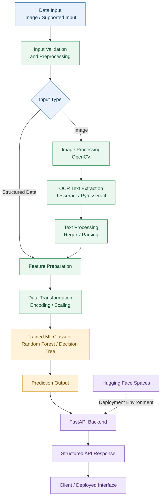

# NAFLD Risk Prediction System

**An AI-powered Machine Learning application for Non-Alcoholic Fatty Liver Disease (NAFLD) risk prediction, integrating data preprocessing, OCR-based text extraction, and API deployment.**

The project demonstrates an end-to-end machine learning workflow, from exploratory data analysis and model development to performance evaluation and deployment using **FastAPI** and **Hugging Face Spaces**.

> **Disclaimer:** This project is intended for educational and research purposes only. It is not a clinically validated diagnostic system and must not replace professional medical evaluation.

---

## Table of Contents

- [Project Overview](#project-overview)
- [Key Features](#key-features)
- [System Architecture](#system-architecture)
- [Technology Stack](#technology-stack)
- [Machine Learning Workflow](#machine-learning-workflow)
- [Model Performance](#model-performance)
- [OCR Integration](#ocr-integration)
- [API and Deployment](#api-and-deployment)
- [Project Structure](#project-structure)
- [Installation and Usage](#installation-and-usage)
- [Future Improvements](#future-improvements)
- [Limitations and Disclaimer](#limitations-and-disclaimer)
- [Author](#author)

---

## Project Overview

Non-Alcoholic Fatty Liver Disease (NAFLD) is a condition characterized by fat accumulation in the liver that is not primarily attributable to alcohol consumption. Early risk assessment and the analysis of relevant health-related features are important areas of medical data research.

This project explores the application of **Machine Learning classification techniques** to predict a target class associated with NAFLD risk.

The system combines a model development pipeline with an OCR component designed to extract text from supported image inputs. A FastAPI backend integrates the relevant processing and prediction functionality, while Hugging Face Spaces provides the deployment environment.

### Project Objectives

- Develop a machine learning classification pipeline.
- Perform exploratory data analysis and feature engineering.
- Prepare numerical and categorical features for model training.
- Evaluate model performance using standard classification metrics.
- Integrate OCR capabilities for image-based text extraction.
- Expose application functionality through a FastAPI backend.
- Deploy the application using Hugging Face Spaces.

## Key Features

- **Machine Learning Classification:** Development and evaluation of classification models, including Random Forest and Decision Tree where applicable.
- **Exploratory Data Analysis:** Investigation of data distributions, feature relationships, and class balance.
- **Feature Engineering:** Preparation of relevant features for model development.
- **Data Preprocessing:** Encoding categorical variables and scaling numerical features when required.
- **Model Evaluation:** Assessment using accuracy, precision, recall, F1-score, and classification reports.
- **OCR Integration:** Text extraction using Tesseract OCR, Pytesseract, and OpenCV.
- **REST API Development:** Backend integration using FastAPI.
- **Model Serialization:** Loading trained model artifacts using Joblib.
- **Cloud Deployment:** Hosting through Hugging Face Spaces.

---

## System Architecture

The following diagram illustrates the conceptual flow of the application, from input processing to model inference and API response.



### Architecture Components

| Component | Responsibility |
|---|---|
| Input Layer | Receives supported input data or image files. |
| Image Processing | Prepares image data for OCR processing. |
| OCR Engine | Extracts text from supported images. |
| Text Processing | Processes extracted text using parsing and regular expressions. |
| Feature Preparation | Organizes the information into the expected model input format. |
| Data Transformation | Applies the preprocessing required by the trained model. |
| ML Classifier | Generates a prediction for the input features. |
| FastAPI Backend | Handles requests and returns prediction results. |
| Hugging Face Spaces | Provides the deployment environment for the application. |

*Note: The diagram represents the intended processing architecture. The actual implementation may differ depending on the supported input formats and the application's endpoint logic.*

---

## Technology Stack

| Category | Technologies |
|---|---|
| Programming Language | Python |
| Data Manipulation | NumPy, Pandas |
| Data Visualization | Matplotlib, Seaborn |
| Machine Learning | Scikit-learn |
| Preprocessing | OneHotEncoder, ColumnTransformer, StandardScaler |
| Model Persistence | Joblib |
| Image Processing | OpenCV |
| OCR | Tesseract OCR, Pytesseract |
| API Framework | FastAPI |
| API Server | Uvicorn |
| Development Environment | Jupyter Notebook |
| Deployment Platform | Hugging Face Spaces |

---

## Machine Learning Workflow

The notebook follows a structured machine learning workflow.

### 1. Importing Dependencies

Import the required libraries for data analysis, preprocessing, model development, evaluation, and visualization.

### 2. Loading the Dataset

Load the dataset using Pandas and inspect its structure, data types, and initial records.

### 3. Exploratory Data Analysis (EDA)

Investigate the dataset to understand:

- Feature distributions and statistical summaries.
- Missing values and potential data quality issues.
- Relationships between features.
- Target class distribution and possible imbalance.

### 4. Feature Engineering

Prepare the relevant input features and target variable for classification.

### 5. Data Preprocessing and Transformation

Apply the required preprocessing techniques, including categorical encoding and numerical scaling where appropriate.

Scikit-learn transformers can be combined using `ColumnTransformer` and `Pipeline` to maintain consistent transformations between training and inference.

### 6. Data Visualization

Use Matplotlib and Seaborn to explore distributions, relationships, and model evaluation results.

### 7. Splitting the Dataset

Split the dataset into training and testing subsets to evaluate the model on samples not used for fitting.

### 8. Model Development

Train and compare suitable classification algorithms, such as:

- Random Forest Classifier
- Decision Tree Classifier

The final deployed model should match the classifier selected during experimentation.

### 9. Model Evaluation

Evaluate the model using:

- Accuracy
- Precision
- Recall
- F1-score
- Confusion Matrix
- Classification Report

### 10. Model Deployment

Serialize the trained model, integrate the required preprocessing and inference logic into a FastAPI application, and deploy the application using Hugging Face Spaces.

---

## Model Performance

The model was evaluated on a test set containing **2,000 samples**.

### Classification Report

| Metric | Class 0 | Class 1 |
|---|---:|---:|
| Precision | 0.95 | 0.74 |
| Recall | 0.84 | 0.91 |
| F1-score | 0.89 | 0.82 |
| Support | 1,339 | 661 |

### Overall Evaluation Metrics

| Metric | Score |
|---|---:|
| Accuracy | 86% |
| Macro Average Precision | 0.84 |
| Macro Average Recall | 0.88 |
| Macro Average F1-score | 0.85 |
| Weighted Average Precision | 0.88 |
| Weighted Average Recall | 0.86 |
| Weighted Average F1-score | 0.87 |

### Performance Interpretation

**Accuracy — 86%**

The model correctly classified approximately 86% of the samples in the test set.

**Class 1 Recall — 91%**

The model correctly identified approximately 91% of the actual Class 1 samples. This metric measures the proportion of actual Class 1 samples that were identified by the classifier.

**Class 1 Precision — 74%**

Approximately 74% of the samples predicted as Class 1 actually belonged to Class 1. The remaining predictions were false positives relative to the dataset labels.

**Class 1 F1-score — 82%**

The F1-score provides a combined measure of precision and recall for Class 1.

**Weighted Average F1-score — 87%**

The weighted F1-score summarizes performance across both classes while accounting for the number of samples in each class.

### Evaluation Summary

The results indicate an overall accuracy of 86%, with a higher recall for Class 1 than for Class 0.

The difference between precision and recall for Class 1 suggests a trade-off between identifying positive cases and avoiding false-positive predictions.

> **Important:** Class 0 and Class 1 are dataset labels. Their exact meanings must be confirmed from the dataset documentation. These metrics should not be interpreted as proof of clinical diagnostic accuracy.

---

## OCR Integration

The application incorporates Optical Character Recognition (OCR) to extract text from supported image inputs.

### OCR Technologies

**OpenCV**

Used for image handling and any preprocessing steps implemented before text extraction.

**Pytesseract**

Provides the Python interface for extracting text through the Tesseract OCR engine.

**Regular Expressions**

The `re` module can be used to identify, match, and parse relevant patterns in the extracted text.

### OCR Processing Workflow

1. Receive an image through the supported input interface.
2. Load and process the image using OpenCV.
3. Extract text using Pytesseract.
4. Apply text parsing and regular expressions where required.
5. Validate and transform the extracted information into the expected input format.
6. Pass valid features to the prediction pipeline, if supported by the application.

OCR output can contain recognition errors. Therefore, extracted values should be validated before being used for prediction.

---

## API and Deployment

### FastAPI Backend

FastAPI serves as the application backend and connects the input-processing workflow with the trained machine learning model.

The implementation imports components such as:

- `FastAPI` for creating the application.
- `UploadFile` and `File` for handling uploaded files.
- `HTTPException` for reporting application errors.
- `joblib` for loading serialized model artifacts.
- `pandas` and `numpy` for data preparation.
- `cv2` and `pytesseract` for image processing and OCR.

The available endpoints and their exact request and response formats depend on the implementation in the application source code.

### Deployment Platform

The application is deployed on **Hugging Face Spaces**.

- **Live Demo:** [Open the deployed application](https://alimoking2003-non-alcoholic-fatty-liver.hf.space)
- **GitHub Repository:** [View the source code](https://github.com/ali-mohamed-01/NAFLD-Detection-and-Risk-Prediction)

Replace both placeholder URLs with the actual project links before publishing this README.

---

## Project Structure

The following is a suggested structure. Update the filenames and directories to reflect the actual repository.

```text
NAFLD-Risk-Prediction/
│
├── notebooks/
│   └── NAFLD_Model_Development.ipynb
│
├── models/
│   └── RandomForestClassifier_model.pkl
│
├── app.py
├── requirements.txt
├── README.md
└── .gitignore
```

### File Descriptions

| File / Directory | Description |
|---|---|
| `notebooks/` | Jupyter notebooks for data analysis and model development. |
| `models/` | Serialized model artifacts, if stored in the repository. |
| `app.py` | FastAPI application entry point, if this is the actual filename. |
| `requirements.txt` | Python dependencies required by the application. |
| `README.md` | Project documentation. |
| `.gitignore` | Files and directories excluded from version control. |

Avoid committing sensitive information, private datasets, or large model artifacts without considering their size, licensing, and privacy implications.

---

## Installation and Usage

### Prerequisites

- Python 3.10 or another version supported by the project's dependencies.
- Git.
- Tesseract OCR installed and configured if OCR functionality is required.
- Access to the model artifact used by the application.

### 1. Clone the Repository

```bash
git clone YOUR_GITHUB_REPOSITORY_URL
cd NAFLD-Risk-Prediction
```

Replace `YOUR_GITHUB_REPOSITORY_URL` with the actual repository URL.

### 2. Create a Virtual Environment

```bash
python -m venv venv
```

Activate the environment on Windows:

```bash
venv\Scripts\activate
```

On macOS or Linux:

```bash
source venv/bin/activate
```

### 3. Install Dependencies

```bash
pip install -r requirements.txt
```

If the project does not yet contain a `requirements.txt` file, create one containing the actual dependencies and compatible versions used by the application.

Tesseract OCR is a separate system dependency and may require additional installation and configuration.

### 4. Run the FastAPI Application

If the application file is `app.py` and the FastAPI instance is named `app`, start the development server with:

```bash
uvicorn app:app --reload
```

### 5. Access the API Documentation

Open the following URL in your browser:

```text
http://127.0.0.1:8000/docs
```

FastAPI generates interactive API documentation for the endpoints defined by the application.

*The commands above assume the suggested filenames and entry point. Modify them if your project uses a different structure.*

---

## Future Improvements

Potential improvements include:

- Hyperparameter tuning and systematic model comparison.
- Cross-validation to evaluate performance across multiple data splits.
- Confusion matrix visualization and detailed error analysis.
- Independent validation using representative datasets.
- Improved OCR preprocessing and extracted-text validation.
- More robust API input validation and error handling.
- Automated testing for preprocessing, inference, and API endpoints.
- Model versioning and reproducible deployment.
- Explainability techniques to better understand model predictions.
- Monitoring performance and potential data drift after deployment.

---

## Limitations and Disclaimer

This project is an educational machine learning application and is not a clinically validated medical diagnostic tool.

- The reported metrics describe performance on the provided test set only.
- The meaning of each target class depends on the original dataset labels.
- Performance on new or independent data may differ from the reported results.
- OCR can introduce errors that affect downstream predictions.
- Clinical use would require appropriate validation, assessment of bias, privacy safeguards, and review by qualified healthcare professionals.

**Do not use this system as a substitute for professional medical advice, diagnosis, or treatment.**

---

## Author

**Ali Mohamed Ali**

AI Engineer | Machine Learning | Data Analysis

- **GitHub:** [ali-mohamed-01](https://github.com/ali-mohamed-01)
- **Portfolio:** [My Portfolio](https://ali-mohamed-01.github.io/My_Portfolio/)

---

*An applied machine learning project demonstrating data analysis, classification, OCR integration, API development, and cloud deployment.*
